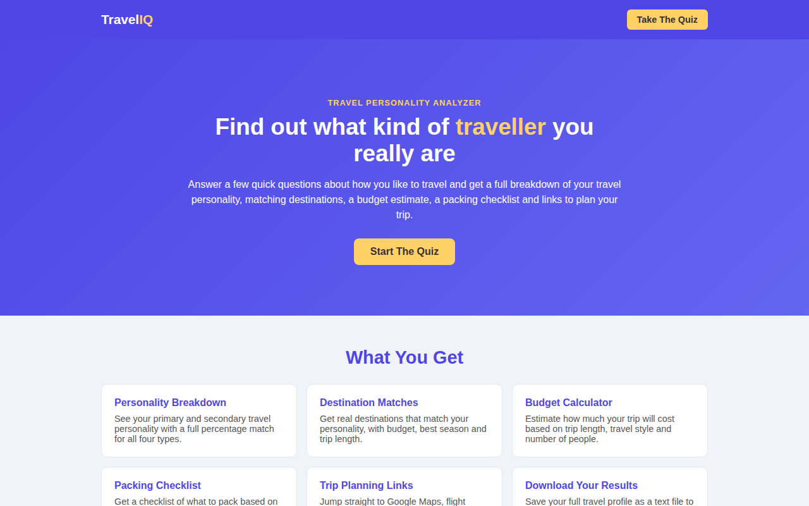
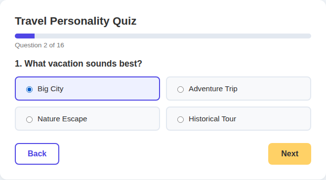
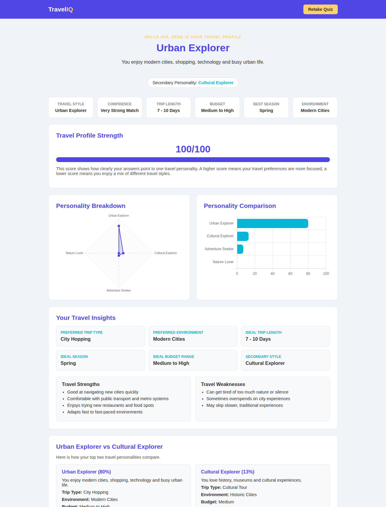
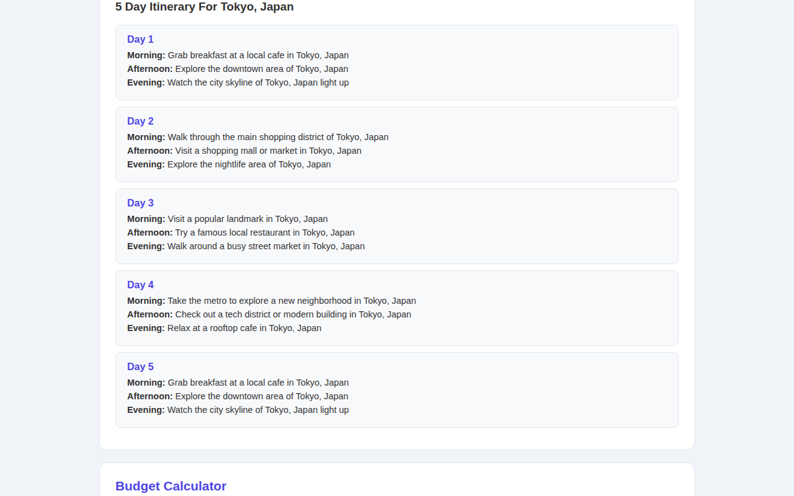

# Travel Personality Analyzer

**Answer 15 questions. Leave with a travel style, destinations, a budget, and a day-by-day plan.**

Travel Personality Analyzer is a free [travel personality quiz](https://github.com/ryaneditraj/Personality-Analyzer) for people who want a trip that fits how they actually travel. It scores four styles — Urban Explorer, Adventure Seeker, Nature Lover, and Cultural Explorer — then shows matching destinations, a packing list, a budget sketch, and a simple itinerary.

No account. No API key. Answers are not stored.

[](https://www.python.org/)
[](https://flask.palletsprojects.com/)
[](LICENSE)
[](https://github.com/ryaneditraj/Personality-Analyzer/actions/workflows/ci.yml)

## Demo

These screenshots are from a local run of this repository.









## Features

- **15-question travel personality quiz** with a progress bar and one question at a time
- **Four travel styles**, plus a secondary style and a percentage for every style
- **Destination matches** with budget, season, trip length, and why it fits
- **Planning links** for Google Maps, flight search, hotels, and Google Calendar
- **Budget calculator** in INR, USD, or EUR
- **Day-by-day itinerary** for a matched destination
- **Packing checklist**, travel tips, and short fun facts
- **Side-by-side comparison** of your top two styles
- **Share or save** with WhatsApp, an email draft, or a `.txt` download

## Tech stack

| Piece | Used for |
| --- | --- |
| Python 3.12 | App and scoring |
| Flask 3.1.3 | Routes and HTML rendering |
| Jinja2 | Homepage and result templates |
| HTML, CSS, and JavaScript | Quiz flow, charts, budget, and calendar links |
| [Chart.js 4.4.1](https://www.chartjs.org/) | Radar and bar charts on the result page |

Maps, flights, hotels, calendar, WhatsApp, and email are normal links. The project does not call their APIs and does not need keys.

## Quick start

```bash
python3 -m venv .venv
source .venv/bin/activate
pip install -r requirements.txt
cp .env.example .env
python app.py
```

Open http://127.0.0.1:5001.

On Windows, activate the virtual environment with `.venv\Scripts\activate`.

Leave `FLASK_DEBUG` at `0` unless you are developing on your own machine. Set `FLASK_DEBUG=1` in `.env` when you want the debugger. See [SECURITY.md](SECURITY.md) before you expose the app to anyone else.

## Usage

1. Open the homepage and choose **Start The Quiz**.
2. Enter a name, then answer all 15 questions. **Next** asks you to answer the current question before it moves on.
3. Submit **Analyze My Personality**.
4. Read the primary and secondary styles, the charts, and the destination cards.
5. Use **Maps**, **Flights**, **Hotels**, or **Calendar** on a destination.
6. Generate an itinerary, calculate a budget, check off packing items, then share or download the result.

Daily costs are rough figures in Indian rupees. USD and EUR use a fixed rate (`1 INR ≈ 0.012 USD` and `0.011 EUR`). Treat the total as a sketch, not a fare.

## Project structure

```text
app.py                 Quiz scoring, destinations, itineraries, and routes
templates/index.html   Homepage, FAQ, and the quiz
templates/result.html  Result dashboard
static/quiz.js         Question steps and progress
static/results.js      Charts, budget, calendar, download, itinerary
static/styles.css      Layout and color
tests/test_app.py      Homepage, scoring, escaping, and discovery routes
docs/screenshots/      Images used in this README
```

## Roadmap

- Live exchange rates in place of the fixed INR conversion
- Destination-specific itinerary lines, not only style templates
- A public hosted demo, with `SITE_URL` set to that origin
- More questions and destinations without changing the four-style model
- An accessibility pass for keyboard focus and chart text alternatives

Saved profiles and accounts are intentionally not on the list. The quiz is useful because it forgets the form when the response is sent.

## Contributing

Read [CONTRIBUTING.md](CONTRIBUTING.md) for setup, tests, and pull requests. Behavior toward other people is covered by the [Code of Conduct](CODE_OF_CONDUCT.md).

## Security

The app has no API keys. Vulnerability reports go to the email in [SECURITY.md](SECURITY.md), not into a public issue.

## License

[MIT](LICENSE) © 2026 Ryan Editraj

## Author

**Ryan Editraj** — AI builder and tech creator.

- GitHub: [github.com/ryaneditraj](https://github.com/ryaneditraj)
- Instagram: [instagram.com/ryaneditraj](https://instagram.com/ryaneditraj)

Built with love for Off-Track Hack Club YSWS.

## FAQ

### What is the Travel Personality Analyzer?

It is a free travel personality quiz. Fifteen questions turn the way you like to travel into a primary style, a secondary style, destination ideas, a budget sketch, a packing list, and a short itinerary.

### How does the travel personality quiz calculate a result?

Each answer adds two points to one style. Your primary personality is the style with the largest share of those points. The next style is the secondary personality. A match score then looks at how far the top style sits ahead of the second. The math is ordinary addition, not a machine-learning model.

### Which travel personalities can I get?

Urban Explorer, Adventure Seeker, Nature Lover, and Cultural Explorer. The result page still lists the other styles as percentages, so a mixed trip style stays visible.

### Does this travel quiz need an API key or an account?

No. Flight, hotel, map, calendar, WhatsApp, and email actions are links built from the destination name. You can clone the repository and run it locally without signing up for a service.

### Is the budget calculator an exact trip price?

No. It multiplies a daily estimate for your travel style by the number of days and people. Dollar and euro amounts use a fixed rate, so the number is a planning sketch.

### Does the quiz store my answers?

No. There is no database. The server scores the form for that request and does not keep it. Download the text file if you want a copy.

### Can I share my travel personality result?

Yes. The result page opens a WhatsApp message, an email draft, or a `.txt` download. It can also open a Google Calendar event for a recommended destination.

### Who made Travel Personality Analyzer?

Ryan Editraj ([@ryaneditraj](https://github.com/ryaneditraj)), an AI builder and tech creator. Source and issues live on GitHub. Updates also show up on [Instagram](https://instagram.com/ryaneditraj).
